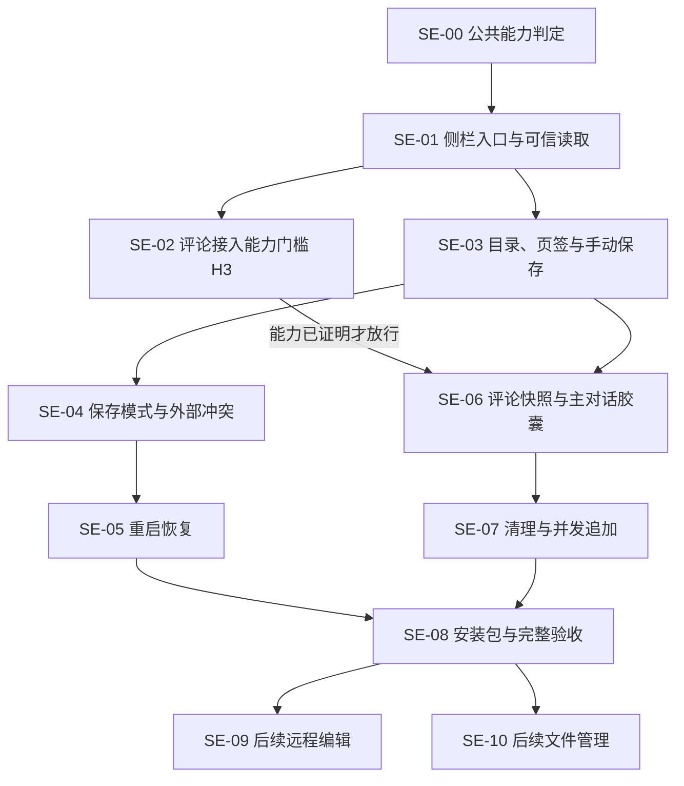

# suian-side-editor 开票索引

日期：2026-10-12。状态：用户已批准规格、粒度与发布，11 张 GitHub Issues 已创建；SE-00 已验证，SE-01 的只读基础切片及 H1/H2 实测证据已集成并通过两轴复核。SE-02／03 已开始实施，H3 仍待证明。

实施启动：用户已要求在规格工作树按 implement-spec 执行。统一集成分支为 codex/side-editor-plan，实际基线已核对到 dev 的 b48e8a4；该提交与规划起点 403f877 的文件树一致。单票使用独立子工作树，合并由专门代理串行验证；本轮实施不包括后续 SE-09／10。

需求共识与 [首版规格](text-editor-spec.md) 已由用户整体确认，见 [设计澄清](design-discussion.md)。完整规格与公开索引附于 [#40](https://github.com/ONEGAYI/ZCode-Plugins/issues/40)，SE 标识继续用于本地规划，实际编号如下。

## 票与依赖

首版共 9 票，其中一张必要准备重构、一张宿主能力门槛；另有 2 张用户要求的后续特性占位。

| 本地标识 | GitHub | 交付行为 | Blocked by | 当前状态 |
| --- | --- | --- | --- | --- |
| [SE-00](issues/00-shared-ui-capability.md) | [#40](https://github.com/ONEGAYI/ZCode-Plugins/issues/40) | 提取现有原生 UI 能力判定，保持工件插件行为 | 无 | 本地实现、集成与两轴审查通过 |
| [SE-01](issues/01-sidebar-context-and-read.md) | [#41](https://github.com/ONEGAYI/ZCode-Plugins/issues/41) | 从独立侧栏冷启动，可信绑定当前工作区并读取文本 | #40 | 本地实现、H1/H2 实测与两轴复核通过 |
| [SE-02](issues/02-main-composer-capability.md) | [#42](https://github.com/ONEGAYI/ZCode-Plugins/issues/42) | 验证主对话评论接入能保持原生的并发清理语义 | #41 | 接入探针实施中；H3 待证明 |
| [SE-03](issues/03-tree-tabs-and-manual-save.md) | [#43](https://github.com/ONEGAYI/ZCode-Plugins/issues/43) | 浏览目录、打开临时或固定文件页并手动编辑保存 | #41 | SDK 19/19 与构建浏览器通过；Native 保存烟测及两轴复核待进行 |
| [SE-04](issues/04-save-mode-and-conflicts.md) | [#44](https://github.com/ONEGAYI/ZCode-Plugins/issues/44) | 持久化会话保存模式，自动保存并处理外部修改 | #43 | 等待依赖及能力条件 |
| [SE-05](issues/05-durable-editor-recovery.md) | [#45](https://github.com/ONEGAYI/ZCode-Plugins/issues/45) | 恢复打开页、未保存正文、焦点页面与阅读位置 | #44 | 等待依赖及能力条件 |
| [SE-06](issues/06-selection-comment-context.md) | [#46](https://github.com/ONEGAYI/ZCode-Plugins/issues/46) | 将完整的选区评论快照加入当前主对话胶囊 | #42、#43 | 等待依赖及能力条件 |
| [SE-07](issues/07-send-cleanup-and-concurrent-comments.md) | [#47](https://github.com/ONEGAYI/ZCode-Plugins/issues/47) | 自动清理已受理评论，保留发送期间新增评论 | #46 | 等待依赖及能力条件 |
| [SE-08](issues/08-package-and-end-to-end-acceptance.md) | [#48](https://github.com/ONEGAYI/ZCode-Plugins/issues/48) | 完成独立插件安装包与首版端到端验收 | #45、#47 | 等待依赖及能力条件 |
| [SE-09](issues/09-future-remote-workspace.md) | [#49](https://github.com/ONEGAYI/ZCode-Plugins/issues/49) | 后续特性：远程工作区文本编辑 | #48 | 后续待做 |
| [SE-10](issues/10-future-file-management.md) | [#50](https://github.com/ONEGAYI/ZCode-Plugins/issues/50) | 后续特性：新建、重命名与删除文件 | #48 | 后续待做 |

SE-00 是与功能分开的必要小重构。SE-01 建立原生入口和可信文件读取；SE-03／04／05 提供可独立验证的编辑、保存及恢复路径，不被评论能力调查阻断。

SE-02 不是“调研完成就放行”：只有 H3 实际满足才解除 SE-06／07 及完整验收的能力阻塞。缺少接口时记录具名条件并保持阻塞，首版并发评论不得自动降级。

## 依赖图

一种有效顺序为 SE-00 → SE-01 → SE-02／SE-03 → SE-04 → SE-05 → SE-06 → SE-07 → SE-08。此处两条分支独立仅表示依赖关系，不自动授权多个 Agent、修改主工作树或运行宿主写探针。

## 发布与实施约定

2026-10-12 已核对现有标签。11 票均使用 enhancement，能力调查 #42 另加 question；没有新建标签或使用不存在的 ready-for-agent。

- 发布票前读取现有 GitHub 标签，不自动创建标签体系。依赖未满足不标 ready-for-agent。
- GitHub 票附可访问的完整规格或实际规格票引用；不能只链接尚未推送的本地文档，不猜实际 Issue 编号。
- 首张 #40 已附完整规格，其余票引用该实际编号；本轮未额外创建规格父票，共发布 11 票。
- 发布按拓扑顺序进行；保留父票，不关闭或改写已有工件区票。
- SE-09／10 标为后续待做，不列入首版验收、不默认开始。
- 创建票不等于实施、推送、建 PR、正式合入 master 或发布版本的授权。
- 代码开发在独立工作树基于开发分支推进；不切换用户主工作树。正式集成时按实际影响同步版本。
- 具体流程见 [开票约定](agents/issue-tracker.md)。

## 已批准的工程选型

CodeMirror 6 用于浏览器文本编辑；插件自有 SQLite 保存模式与恢复状态，见 [ADR 0004](adr/0004-editor-owned-sqlite-state.md)。公共层只提取已存在且确实重复的能力判定；原 Host 订阅扩展须由 SE-02 的实证需要决定。

本索引不宣称接口缺口已解决，也不把技术验证表述为用户验收。
