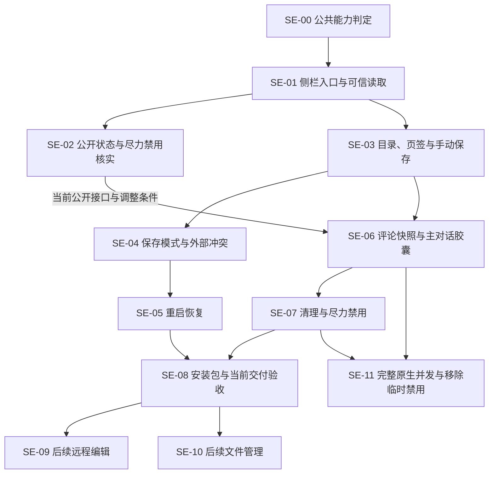

# suian-side-editor 开票索引

日期：2026-10-12，实施状态更新至 2026-10-13。用户已批准规格、粒度与发布，既有 11 张 GitHub Issues 已创建且均未关闭，完整并发拆为 SE-11，新票 [#57](https://github.com/ONEGAYI/ZCode-Plugins/issues/57) 已创建且保持 open；SE-00／01／03 已完成本地验证及两轴复核，SE-03 的限定 Native 烟测也已通过。SE-04 的本地限定条件已闭合；SE-05 的来源及统一代码两轴、SDK37／浏览器55、H4 三类生命周期、源 Native 文档两轴及本地限定条件已通过，最终统一文档两轴待根复核，当前结论见 [实施总记录](development-verification.md)。历史记录保留当次视觉与生命周期边界；原 H3 完整能力、正式安装及用户产品验收仍未通过。2026-10-13 用户已接受发送边界残余风险，当前 #42／46／47／48 可按已核公开会话状态尽力禁用推进，具体接口和临时行为仍须验证；完整原生并发由 SE-11 独立验收。

实施启动：用户已要求在规格工作树按 implement-spec 执行。统一集成分支为 codex/side-editor-plan，实际基线已核对到 dev 的 b48e8a4；该提交与规划起点 403f877 的文件树一致。单票使用独立子工作树，合并由专门代理串行验证；当前实施不自动包含后续 SE-09／10 或完整 SE-11；SE-11 能力调查可独立推进，实际完整实现另按届时授权。

需求共识与 [首版规格](text-editor-spec.md) 已由用户整体确认，见 [设计澄清](design-discussion.md)。完整规格与公开索引附于 [#40](https://github.com/ONEGAYI/ZCode-Plugins/issues/40)，SE 标识继续用于本地规划，实际编号如下。

## 票与依赖

当前交付共 9 票，其中一张必要准备重构、一张公开接口与临时方案调查票；另有 2 张原有后续特性及 1 张新拆出的完整原生并发特性。

| 本地标识 | GitHub | 交付行为 | Blocked by | 当前状态 |
| --- | --- | --- | --- | --- |
| [SE-00](issues/00-shared-ui-capability.md) | [#40](https://github.com/ONEGAYI/ZCode-Plugins/issues/40) | 提取现有原生 UI 能力判定，保持工件插件行为 | 无 | 本地实现、集成与两轴审查通过 |
| [SE-01](issues/01-sidebar-context-and-read.md) | [#41](https://github.com/ONEGAYI/ZCode-Plugins/issues/41) | 从独立侧栏冷启动，可信绑定当前工作区并读取文本 | #40 | 本地实现、H1/H2 实测与两轴复核通过 |
| [SE-02](issues/02-main-composer-capability.md) | [#42](https://github.com/ONEGAYI/ZCode-Plugins/issues/42) | 核实公开状态、尽力禁用及已接受风险 | #41 | 原调查完成；用户授权调整后可继续核实接口与临时方案，未实现／验证完整同步保证 |
| [SE-03](issues/03-tree-tabs-and-manual-save.md) | [#43](https://github.com/ONEGAYI/ZCode-Plugins/issues/43) | 浏览目录、打开临时或固定文件页并手动编辑保存 | #41 | 本地代码、整合、限定 Native 烟测与两轴复核通过 |
| [SE-04](issues/04-save-mode-and-conflicts.md) | [#44](https://github.com/ONEGAYI/ZCode-Plugins/issues/44) | 持久化会话保存模式，自动保存并处理外部修改 | #43 | 本地限定条件、代码／文档两轴、Native 分层证据及整合通过；视觉与用户验收未过 |
| [SE-05](issues/05-durable-editor-recovery.md) | [#45](https://github.com/ONEGAYI/ZCode-Plugins/issues/45) | 恢复打开页、未保存正文、焦点页面与阅读位置 | #44 | 代码两轴、SDK37／浏览器55、H4 与源 Native 文档两轴通过，本地限定条件已满足；最终统一文档两轴待复核 |
| [SE-06](issues/06-selection-comment-context.md) | [#46](https://github.com/ONEGAYI/ZCode-Plugins/issues/46) | 将完整的选区评论快照加入当前主对话胶囊 | #42、#43 | 按已接受风险的尽力禁用范围可推进，实际快照与临时行为未实现 |
| [SE-07](issues/07-send-cleanup-and-concurrent-comments.md) | [#47](https://github.com/ONEGAYI/ZCode-Plugins/issues/47) | 正常／失败／排队及缓存清理，公开状态尽力禁用评论 | #46，#42 调整条件 | 依赖实际评论实施，完整并发已拆出；未实现／验证当前闭环 |
| [SE-08](issues/08-package-and-end-to-end-acceptance.md) | [#48](https://github.com/ONEGAYI/ZCode-Plugins/issues/48) | 安装包与调整范围后的端到端验收 | #45、#47，#42 调整条件 | 评论闭环与正式安装未验；H4 已有限定证据；不等待完整 SE-11 |
| [SE-09](issues/09-future-remote-workspace.md) | [#49](https://github.com/ONEGAYI/ZCode-Plugins/issues/49) | 后续特性：远程工作区文本编辑 | #48 | 后续待做 |
| [SE-10](issues/10-future-file-management.md) | [#50](https://github.com/ONEGAYI/ZCode-Plugins/issues/50) | 后续特性：新建、重命名与删除文件 | #48 | 后续待做 |
| [SE-11](issues/11-native-concurrent-comment-feature.md) | [#57](https://github.com/ONEGAYI/ZCode-Plugins/issues/57) | 完整原生并发：在途追加、精确批次清理、移除临时禁用 | 实际集成依赖 #46、#47；公开能力调查可独立推进 | 用户要求拆出的完整特性，尚未实现／验收，当前尽力路径通过不代表完成 |

SE-00 是与功能分开的必要小重构。SE-01 建立原生入口和可信文件读取；SE-03／04／05 提供可独立验证的编辑、保存及恢复路径，不被评论能力调查阻断。

**当前按最新风险授权推进**：用户已接受发送边界残余风险，SE-02 核实实际公开状态和尽力禁用限制，SE-06／07／08 不再等待原 H3 完整并发或同步／原子状态接口。状态可能迟到、受理后恢复可能早于 Renderer 清理；若用 running 保守代理，可能整个回复期间锁定，必须明示。

实际完整字段、可信归属、隔离、全部提交入口禁用／tooltip／草稿保留／恢复及正常／失败／排队缓存闭环仍须验证。SE-11 保留完整同步 pending／消费批次和原生在途追加，当前调整不等于完整能力已实现或用户产品验收。

## 依赖图

一种有效顺序为 SE-00 → SE-01 → SE-02／SE-03 → SE-04 → SE-05 → SE-06 → SE-07 → SE-08。此处两条分支独立仅表示依赖关系，不自动授权多个 Agent、修改主工作树或运行宿主写探针。

## 发布与实施约定

2026-10-12 已核对现有标签。既有 11 票均使用 enhancement，能力调查 #42 另加 question；保留现有标签与 open 状态。2026-10-13 根创建 #57 时使用 enhancement／wait-for-upstreaming，完整宿主能力未满足；文档拆分不擅自增删旧票标签或关票。

- 发布票前读取现有 GitHub 标签，不自动创建标签体系。依赖未满足不标 ready-for-agent。
- GitHub 票附可访问的完整规格或实际规格票引用；不能只链接尚未推送的本地文档，不猜实际 Issue 编号。
- 首张 #40 已附完整规格，其余票引用该实际编号；原轮未额外创建规格父票，共发布 11 票；本次另建 SE-11，实际新票为 #57，并为新票及旧 #42／46／47／48 提供本次完整独立正文。
- 发布按拓扑顺序进行；保留父票，不关闭或改写已有工件区票。
- SE-09／10 保留后续待做；SE-11 是独立完整特性，不列入当前尽力禁用交付验收，不默认开始完整实现。
- 创建票不等于实施、推送、建 PR、正式合入 master 或发布版本的授权。
- 代码开发在独立工作树基于开发分支推进；不切换用户主工作树。正式集成时按实际影响同步版本。
- 具体流程见 [开票约定](agents/issue-tracker.md)。

## 已批准的工程选型

CodeMirror 6 用于浏览器文本编辑；插件自有 SQLite 保存模式与恢复状态，见 [ADR 0004](adr/0004-editor-owned-sqlite-state.md)。公共层只提取已存在且确实重复的能力判定；原 Host 订阅扩展须由 SE-02 核实的实际接口需要决定。当前评论范围调整见 [ADR 0005](adr/0005-temporary-comment-send-guard.md)。

本索引不宣称接口缺口已解决，也不把技术验证表述为用户验收。
