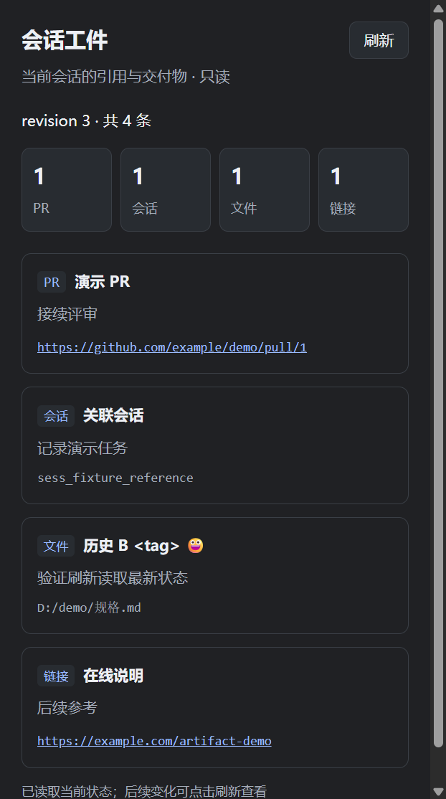
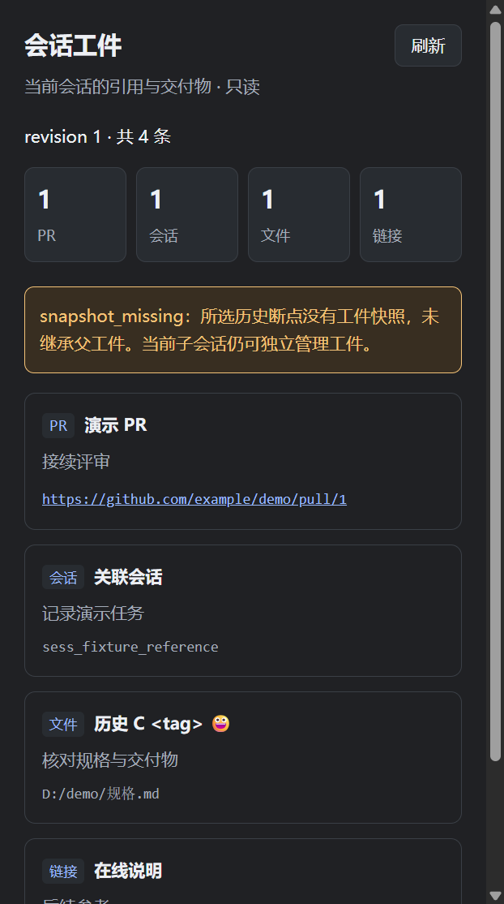

# 工件 demo 开发验证

2026-10-12，在独立工作树本地实施；未推送、发布或迁移用户安装。规格见 [artifact-zone-spec.md](artifact-zone-spec.md)。

## 已实施的行为

- 十二个 MCP 工具中，新增当前会话 get_artifacts / set_artifacts。真实 SQLite 保存状态；get 每次重新读取，set 在同一事务内检查 revision、应用增量和校验容量。
- 原生 SessionStart 幂等初始化，UserPromptSubmit 输出管理说明与分类统计，Stop 同步提交消息断点快照。普通空 get 不创建工件库。
- 原生分叉按隐藏 forkOrigin 的原始父消息 ID 继承；子版本从 0 独立计数。snapshot_missing 是保留的继承诊断，后续读写仍正常。
- 原生只读页共用 get，显示 revision、统计、条目与诊断，条目使用 textContent。页面只提供刷新和 HTTP(S) 引用，不编辑状态、不启动模型。

统计形状为 `stats: { total, by_kind: { pr, session, file, link } }`。set 的 upserted/removed 是实际变化条数，无变化时为 0；成功不回传 items。业务拒绝使用 revision_conflict、invalid_input、capacity_exceeded；参数形状由 MCP SDK 校验，底层存储错误保留错误信息，不假装空集合。

## 自动化契约

Node.js 24.15.0、MCP SDK 1.32.1，使用独立 SQLite 和公开 MCP/stdio 入口。测试命令是 `npm test`，日志在运行首次落盘并记录退出码。

覆盖空读不建库、四类条目与统计、精确 ref、顺序、无变化、冲突与批次原子性、20/21 条、12000/12001 Unicode 码点（含中文和 emoji）、未知/歧义调用者、损坏和不兼容存储、独立进程并发 CAS、全部进程退出后的恢复，以及宿主双库字节不变。

独立规格审查发现首次拒绝写入会回滚新库结构的问题。已补充首次版本冲突和首次容量超限后仍能读取空状态、合法重试的公开 MCP 测试；两项先失败，再修复为独立提交库结构，业务事务仍原子处理 revision 和增量。最终完整回归 101 项通过、0 失败、退出码 0。

规范轴与规格轴的独立复核均通过，原 P1 已解决；固定实现提交记录在脱敏证据中。审查通过和代理自检不代替用户验收，也不补作未执行的真实模型评估。

Hook 从正式 hooks.json 的同步 command 启动。覆盖 A/B 历史继承、同轮多 Stop、相同内容不同消息映射、旧 Stop 重放不改映射、缺快照后继续写入、迟到快照不覆盖子状态、首次 set 初始化，以及提交摘要不含 ref/label/purpose/items。

UI 契约覆盖版本、客户端身份和 MCP Apps MIME 的组合，包括应用 3.15.1 与握手 CLI 0.16.9 的实测组合。旧版、未知版本或能力不足时，两个工具仍保留，UI 元数据和资源不提供。

最终回归数量和独立审查结果见 [脱敏证据](artifact-demo-evidence.json)。

## 真实 Desktop 接线

宿主为 ZCode 3.15.1.8093，构建标识 f18d6db7，随包 CLI 0.16.9。使用全新 profile、用户配置、插件数据、工作区及 Electron 存储；保留原安装文件，不复制用户账号或会话。模型接口是本地合成 OpenAI SSE，只验证工具、Hook 和页面链路。

| 轨迹 | 观察结果 |
| --- | --- |
| 原生生成 A，再生成 B | 正式 MCP 工具保存四类工件，正式同步 Stop 保存原始完成消息映射 |
| 父最新 B，再从旧 A 的“分叉”按钮创建子会话 | 子 SessionStart 保存 A；首次 get 与侧栏显示 A、revision 0，父仍为 B |
| 后台独立 MCP 增量写入，再点页面刷新 | 页面取得新 revision 和条目，合成模型请求数不增加 |
| 删除插件自有的 B 映射，模拟缺快照，再从 B 原生分叉 | 分支创建成功，子记录 snapshot_missing、空集合和 revision 0 |
| 缺快照子会话继续生成 C | 正式 get/set 成功，子完成正常聊天；侧栏显示 C 和保留的缺失诊断 |
| 清空子引用，刷新 | 零统计和空状态，仍明确未继承 |
| 临时损坏隔离工件库，刷新后恢复原字节 | 页面显示读取失败，清除旧列表，不呈现“空工件成功” |

直接采集原生沙箱截图并核对 DOM；还用有 DPI 感知的窗口截图确认实际侧栏布局。主窗口 CDP 组合截图曾显示陈旧、裁切的 guest 图像，不据此修改正常页面 CSS。四类显示、长引用换行、`<tag>` 按文本显示、emoji、空状态与错误均完成代理视觉自检；用户验收仍待进行。

## 宿主限制与版本修正

公开 aac4755 快照把 MCP clientVersion 接到 appVersion；本机 f18d6db7 构建的线协议仍返回 `clientInfo: { name: "zcode", version: "0.16.9" }`。同一 MCP 进程实测收到 `ZCODE_APP_VERSION=3.15.1`，因此门控优先使用 Desktop 的该环境变量，缺失时才读取 ZCode 客户端版本；并要求 `extensions["io.modelcontextprotocol/ui"].mimeTypes` 含所需 MIME。页面桥接版本 `1` 不参与判断。

**首开连接仍有宿主限制**。尚未为目标会话建立 MCP lease 时，宿主在装载页面前返回 `MCP App connection is unavailable`。本轮在旧会话恢复和新分叉中观察到；目标连接就绪后重新加载成功。插件页面自身不发起模型请求，也无法在装载前替宿主签发连接凭证。完整的“任何冷会话首开即用”不在本次已通过的验收范围，不把版本与 MIME 满足说成连接一定就绪。

依据：[UI_PLUGIN.md](https://github.com/zai-org/ZCode/blob/aac4755666d09fdcd70272fcf063c077a639015f/UI_PLUGIN.md)、[UI 连接凭证入口](https://github.com/zai-org/ZCode/blob/aac4755666d09fdcd70272fcf063c077a639015f/apps/zcode-cli/packages/bootstrap/src/zcode-protocol/mcp-ui/protocol.ts#L222)、[共享连接池](https://github.com/zai-org/ZCode/blob/aac4755666d09fdcd70272fcf063c077a639015f/apps/zcode-cli/packages/adapters/src/mcp/pool.ts)。

## 真实 Agent 主动维护评估

本轮没有可用于隔离测试的真实模型账号，未复制用户凭据。合成 SSE 按固定脚本发起 get/set，不能证明真实 Agent 会主动登记、维护或清理。该评估保持未执行状态。

后续用已确认的测试模型，在独立项目与会话中运行以下任务，不在任务文本里额外要求“登记工件”：

1. 提供现有 PR、关联会话和规格文件，让 Agent 接手续写验收说明。检查是否只登记有后续用途的引用。
2. 让 Agent 用新规格替换旧规格。检查是否增量 upsert/remove，且保留仍需交付的 PR，不删除资源。
3. 用独立 MCP 连接在 Agent 的 get 后修改状态，制造冲突。检查是否重新 get 和判断增量，避免以旧列表覆盖。
4. 完成任务后再提出接续评审。检查完成但仍有用途的工件是否保留、purpose 是否更新。

每次记录模型与思考档位、任务文本、工具轨迹、最终 SQLite 状态、失败原因、请求数与可取得的 token 成本。不得用已执行的技术夹具替代该结果。

## 发布边界

完整版每请求唯一最新投影仍是 [#36](https://github.com/ONEGAYI/ZCode-Plugins/issues/36) 的等待上游事项。本轮没有修改 ZCode、公共网关实现或实际用户 MCP 设置，也没有推送、建 PR 或合并。隔离进程已退出，临时 profile、数据库和采集原始物料已清理；测试首次日志保留在忽略的验证目录，脱敏证据记录其 SHA256。入库截图仅含合成引用，证据不包含用户目录、账号、会话 ID 或凭据。
