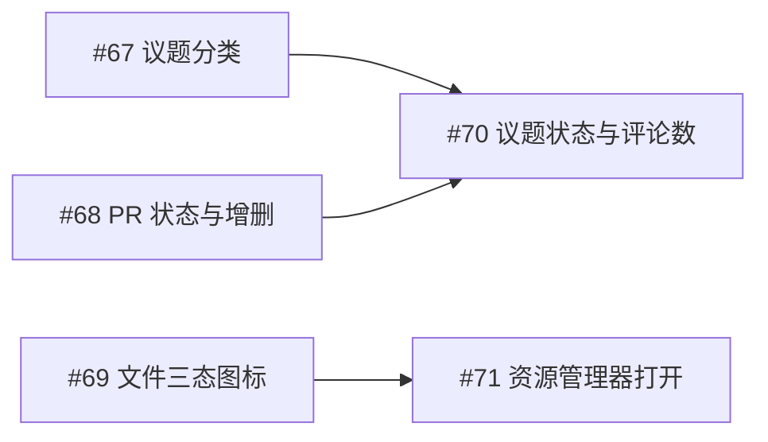

# 工件面板增强开票索引

**状态**：2026-10-15 五票已全部实施并合入 [PR #72](https://github.com/ONEGAYI/ZCode-Plugins/pull/72)（分支 ap-panel-enhance，base dev），经两轮审查循环（三个分层审查子代理 + 独立复核）确认 8 项问题修复闭合、183/183 契约测试全绿，PR 已转正待审查。遗留真机验收项：gh 状态一致性、Windows explorer 打开、五态 logo 观感、面板浏览器端到端（evidence JSON 随真机验收更新）；正式合入 dev 与版本升版待用户指令。上一轮工件区开票见 [工件区开票索引](artifact-zone-tickets.md)（AZ 系列，#27–#31、#36）。

## 需求与已裁决决策

本轮针对工件面板的三项体验增强：新增议题分类、PR/议题实时状态展示、文件分类细化。关键决策已由用户裁决：

- **实时状态数据来源采用方案 B（server 端实时拉取）**：刷新时机与面板标准刷新一致（列表刷新、订阅信号、详情打开/刷新）；拉取出错回退为不显示状态、logo 用默认；超时沿用旧数据，行尾右对齐黄色钟表 logo，tooltip 说明原因。
- **状态枚举全量**：PR 开放/已合并/已关闭/草稿/冲突；议题开放/已关闭。
- **资源管理器打开**：经插件工具实现（宿主 openLink 拒绝 file://）；文件=打开所在目录并选中，文件夹=打开自身；接受该工具为工件区首个操作本机资源的工具。
- **文件第三态**：路径缺失时原图标样式灰化，详情页打开按钮同步灰化。

## 顺序与依赖

| 本地票 | GitHub Issue | 交付行为 | 前置条件 |
| --- | --- | --- | --- |
| [AP-01](artifact-panel-enhance-tickets/01-issue-kind.md) | [#67](https://github.com/ONEGAYI/ZCode-Plugins/issues/67) | issue 分类全链路（校验/统计/工具/注入保底/面板分组与默认 logo，分组紧随 PR） | 无 |
| [AP-02](artifact-panel-enhance-tickets/02-pr-status.md) | [#68](https://github.com/ONEGAYI/ZCode-Plugins/issues/68) | PR 实时状态 logo（五种）与增删行数，含超时/出错降级 | 无（与 #67 并行） |
| [AP-03](artifact-panel-enhance-tickets/03-issue-status.md) | [#70](https://github.com/ONEGAYI/ZCode-Plugins/issues/70) | 议题实时状态 logo 与评论数（气泡+数字） | #67、#68 |
| [AP-04](artifact-panel-enhance-tickets/04-file-kind-states.md) | [#69](https://github.com/ONEGAYI/ZCode-Plugins/issues/69) | 文件/文件夹图标区分与缺失灰化第三态 | 无（与 #67/#68 并行） |
| [AP-05](artifact-panel-enhance-tickets/05-open-in-explorer.md) | [#71](https://github.com/ONEGAYI/ZCode-Plugins/issues/71) | 详情页"用文件资源管理器打开"，缺失时按钮灰化 | #69 |

## 固定依据

- 面板现状与桥能力：宿主 `openLink` 仅放行 http(s)（[pluginUiHostAppHandlers](https://github.com/zai-org/ZCode/blob/aac4755666d09fdcd70272fcf063c077a639015f/packages/ui/src/plugin-ui/app/pluginUiHostAppHandlers.ts)）；MCP app 页面 `window.zcode` 无文件管理器 API，本机定位须经插件工具。
- 保底注入名额由 `by_kind` 键驱动（每类最新 3 条、总 20 条、9000 字符），issue 进入枚举自动生效，无需新逻辑。
- gh 查询字段依据 GitHub CLI `pr view` / `issue view` 的 JSON 输出（state、isDraft、mergeable、additions、deletions、comments）。

## 发布与验证边界

- 发布遵循 [开票约定](agents/issue-tracker.md)：草稿确认后按依赖顺序创建 Issues，回填实际编号；创建 Issue 授权不等于实施授权。
- 实施遵循仓库开发纪律：开发分支验证后合入 dev；版本升版（预计 0.6.0 级）与 CHANGELOG 随正式集成定，同步 marketplace.json。
- 契约测试以 gh/系统命令子进程桩与注入时钟覆盖超时/出错/缓存路径；Windows 资源管理器与真实 gh 拉取做真机验收。
