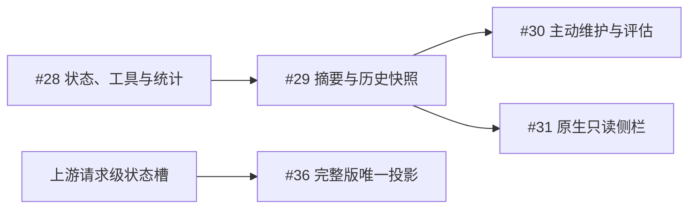

# 工件区开票索引

**状态**：2026-10-11 已将 #28–#31 改为 demo，另创建 [#36 完整版唯一投影](https://github.com/ONEGAYI/ZCode-Plugins/issues/36) 并标记 wait-for-upstreaming。2026-10-12 已在本地实施十二工具与原生接线；公开票尚未因本地实现关闭，真实模型评估和冷会话 UI 连接条件见 [开发验证](artifact-demo-verification.md)。

demo 的四张票保留 enhancement，已移除 wait-for-upstreaming。#28 可实施，#29 依赖 #28，#30 与 #31 依赖 #29；原生只读侧栏是 demo 必需交付。现有仓库没有 ready-for-agent 标签，按项目约定在正文表达就绪状态，不额外创建标签体系。

## 规格与能力依据

[demo 规格](artifact-zone-spec.md)全文附于 [#28](https://github.com/ONEGAYI/ZCode-Plugins/issues/28)，公开票不依赖尚未推送的本地文档。阶段决定见 [ADR 0002](adr/0002-artifact-demo-summary.md)，3.15.1 历史断点的隔离运行见 [分叉核查](artifact-host-fork-audit.md)。

[#27](https://github.com/ONEGAYI/ZCode-Plugins/issues/27) 保持关闭，保留原始严格规格和 3.14.5 核验历史，不修改该调研票的结论来宣称完整版已解决。旧的“分叉操作时冻结父当前状态”已由 demo 的历史断点继承规则替代。

## 顺序与交付

| 本地票 | GitHub Issue | 交付行为 | 前置条件 |
| --- | --- | --- | --- |
| [AZ-01](artifact-zone-tickets/01-host-capabilities.md) | [#27](https://github.com/ONEGAYI/ZCode-Plugins/issues/27) | 原严格目标的发行版能力调研，已关闭 | 历史证据；不再阻塞已调整的 demo |
| [AZ-02](artifact-zone-tickets/02-state-tools.md) | [#28](https://github.com/ONEGAYI/ZCode-Plugins/issues/28) | 当前会话最新 get、增量 set、持久状态与统计 | 无 |
| [AZ-03](artifact-zone-tickets/03-request-projection.md) | [#29](https://github.com/ONEGAYI/ZCode-Plugins/issues/29) | 可累积摘要、同步 Stop 快照与历史断点子初始化 | #28 |
| [AZ-04](artifact-zone-tickets/04-agent-lifecycle.md) | [#30](https://github.com/ONEGAYI/ZCode-Plugins/issues/30) | 主动登记、更新和清理的管理提示词与行为评估 | #29 |
| [AZ-05](artifact-zone-tickets/05-optional-panel.md) | [#31](https://github.com/ONEGAYI/ZCode-Plugins/issues/31) | 按版本/能力启用的原生只读侧栏，demo 必需 | #29；ZCode ≥3.15.1 与所需 UI 能力 |
| [AZ-06](artifact-zone-tickets/06-full-projection-upstream.md) | [#36](https://github.com/ONEGAYI/ZCode-Plugins/issues/36) | 每请求唯一最新完整尾部投影 | 等待具名上游请求级状态槽与支持版本 |

## 已确认规则

- 摘要在用户提交时生成，仅管理提示词和分类统计；允许累积，get 始终最新，get/set 回执更新统计。
- SQLite 保存不可变工件内容和父会话＋完成消息断点映射；无变化仍登记断点，同轮多 Stop 按实际消息绑定。
- 原生分叉继承所选历史完成轮，父后续变化和重复初始化不覆盖子状态。
- snapshot_missing 明确提示继承缺失，但保留分支并允许子工件区后续独立读写和正常聊天。
- UI 以客户端应用版本和 MCP Apps 能力门控，旧版仍保留工具和摘要；不把 bridge version 当作应用版本。
- 完整版唯一投影不作为 demo 的前置条件；不修改 ZCode，不增加分叉工具或外挂网页进程。

## 验证与发布边界

3.15.1.8093 隔离 AgentServer 的历史 A/B、无变化、多 Stop、warm resume 和缺快照后的正常子生成已通过。探针使用临时 SQLite 与合成 SSE，不是生产 MCP 工具、冷恢复、并发或真实 Desktop UI 验收；细节与限制见 [脱敏证据](artifact-turn-snapshot-evidence.json)。

GitHub MCP 与 gh 的网络链路失败后，先从官方 REST 只读核对没有重复新票，再使用现有 GitHub 登录向同仓库发布并回读。凭据未写入文件或日志。#27 状态及正文保持原样。

用户已授权四票改写、完整版发票及开始开发。本地实施遵循 TDD 和独立工作树规则；代码推送、PR 或合并没有获得授权。#28/#29 的工具与快照行为已验证，#30 的管理说明和技能已完成、真实模型评估待执行，#31 的已连接原生侧栏已验证、冷会话首开连接仍有宿主限制。此前 AgentServer 能力探针与本次生产工具/Desktop 接线的证据分别保留。
