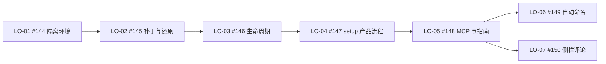

# ZCode 3.16.2 local-only 开票索引

**状态**：2026-10-21 用户已确认设计和粒度，7 张 GitHub Issues 已发布。首轮 5 票、后续 2 票；功能尚未实施，兼容性尚未验收。本轮另获文档推送和通过 PR 合入 dev 的授权，不包含实际安装 patch 或正式分支集成。

规格：[产品接入规格](local-only-spec.md)。事实与裁决：[设计澄清](local-only-design.md)。架构选择：[ADR 0003](adr/0003-local-only-desktop-patch.md)。

## 顺序与依赖

| 本地票 | GitHub | 交付行为 | Blocked by | 范围 |
| --- | --- | --- | --- | --- |
| [LO-01](local-only-tickets/01-isolated-environment.md) | [#144](https://github.com/ONEGAYI/ZCode-Plugins/issues/144) | 交付隔离启动/检查入口、搭建说明和原版离线阻断证据；不修改用户日常安装和运行配置。 | 无 Issue 前置 | 首轮 |
| [LO-02](local-only-tickets/02-patch-and-restore.md) | [#145](https://github.com/ONEGAYI/ZCode-Plugins/issues/145) | 通过公开脚本完成状态/预检、准备、备份、应用、还原，并在隔离包中用原网关建立最小原 Host 连接。 | [#144](https://github.com/ONEGAYI/ZCode-Plugins/issues/144) | 首轮 |
| [LO-03](local-only-tickets/03-offline-lifecycle.md) | [#146](https://github.com/ONEGAYI/ZCode-Plugins/issues/146) | 无 ZCode 登录态且官方远控不可达时可冷启动，网关重启后恢复；显式关闭本地开关时保留官方鉴权链。 | [#145](https://github.com/ONEGAYI/ZCode-Plugins/issues/145) | 首轮 |
| [LO-04](local-only-tickets/04-setup-integration.md) | [#147](https://github.com/ONEGAYI/ZCode-Plugins/issues/147) | 完成模式选择、预检准备、外部应用命令、普通快捷方式重开，以及切回 relay/完整还原的产品流程。 | [#146](https://github.com/ONEGAYI/ZCode-Plugins/issues/146) | 首轮 |
| [LO-05](local-only-tickets/05-mcp-and-guide.md) | [#148](https://github.com/ONEGAYI/ZCode-Plugins/issues/148) | 以无 ZCode 登录态/官方远控不可达的隔离 Desktop 完成 MCP 创建、输入提交、改名、读取和重连，并交付可复现指南与脱敏验收包。 | [#147](https://github.com/ONEGAYI/ZCode-Plugins/issues/147) | 首轮 |
| [LO-06](local-only-tickets/06-title-followup.md) | [#149](https://github.com/ONEGAYI/ZCode-Plugins/issues/149) | 在专用隔离会话中完成真实 Stop 自动命名、固定/解除固定与必要失败反馈的端到端验收。 | [#148](https://github.com/ONEGAYI/ZCode-Plugins/issues/148) | 后续，不计入首轮完成条件 |
| [LO-07](local-only-tickets/07-editor-followup.md) | [#150](https://github.com/ONEGAYI/ZCode-Plugins/issues/150) | 在真实隔离 Desktop 与实际构建侧栏中检验 local-only 评论链路及恢复，明确既有评论限制。 | [#148](https://github.com/ONEGAYI/ZCode-Plugins/issues/148) | 后续，不计入首轮完成条件 |

## 就绪条件与完成边界

LO-01 无 Issue 前置并标记现有 ready-for-agent 标签，表示规格已定、可准备环境；具体运行包仍须按正文取得并核对。其余票只使用现有标签并在正文写依赖，不凭调查完成自动解除 Host 或运行包条件。

**首轮完成**要求 LO-01 至 LO-05 各自验收全部满足：固定单包、数据隔离、原版失败基线、可还原补丁、无登录态离线冷启动/恢复、setup 产品路径、原生 MCP 闭环与复现指南。命名和评论两票不阻塞首轮。

LO-07 不扩展为完整原生并发评论；[#57](https://github.com/ONEGAYI/ZCode-Plugins/issues/57) 独立保留，已关闭 #47 的历史结论不改写。本系列不关闭其它项目的父票或历史票。

## 执行纪律

- 基于 dev 的独立 worktree 实施；研究用 sources 只读，不修改或安装依赖。
- 网关和业务运行代码优先复用。setup 与补丁工具可以按已确认目标修改；静态判断不等于原生验证。
- 实际应用包、备份、control_token、原始日志留在忽略目录，入库只放脱敏文档和最终证据。
- 新行为先红后绿；长流程首次落盘日志及退出码；同输入、环境与范围的有效记录复用，不因提交、PR、合并或交付阶段变化重复全量。
- 代理验证与用户验收分开记录。应用升级后按新包重新核对，未支持包拒绝套用旧补丁。
