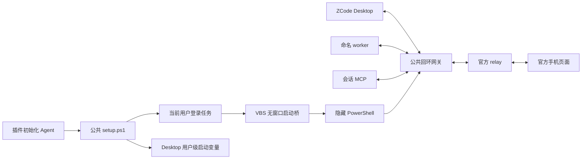

# suian-zcode-common

**业务插件共用的基础能力**：网关、远控协议与探活、DPAPI、Toast、消息投影、原生 UI 能力判定和依赖完整性检查。命名插件保留命名规则，MCP 与侧栏编辑器保留各自业务和数据。公共层不依赖任何插件。

当前版本 `0.2.2` 补充 Agent 代为更新原生插件的操作口径：更新对象是市场副本仓库而非版本缓存，先拉取远端最新 HEAD，按先 common 后业务插件的顺序更新。`0.2.1` 补充远控开关操作与本地模式判定说明。`0.2.0` 新增 Stop 依赖完整性检查：Agent 会话结束时扫描 suian 系列插件的依赖，缺失时以 Toast 提醒，并提供可复制的修复提示词。既有网关、Channel 监听入口与 V4 decoder 保持；仅使用文本编辑功能时无需启动远控网关，评论另需已有连接。

`connectHost` 的 `listen(channel,event,args)` 保留官方直接对象参数及事件监听／dispose 语义，不新增网关协议。`vendor/conversation-wire.js` 由固定上游 `aac4755666d09fdcd70272fcf063c077a639015f` 的49个必要blob编译，提供完整组装、编码及会话快照／历史页schema；来源见 [清单](vendor/conversation-wire.sources.json)。Apache-2.0／完整NOTICE和Zod MIT许可保留，见 [第三方声明](vendor/NOTICE.md)。当前分支分页、受理证明和评论规则属于侧栏插件，不在公共层扩展常驻状态框架。

只有网关是常驻独立进程，其他模块由调用方导入，按需执行。共享代码不等于合并运行数据或给只读 MCP 增加通知。

当前开发分支为 `relay` 模式增加 3.16 V2 适配：使用原版 Desktop，经回环网关转发官方鉴权连接；手机继续连接官方 relay，插件复用同一个 Host 桥。真机双向发信、插件改名与手机显示已验证；尚未发布。独立 `terminal` 模式保留为研究入口，同设备会与手机争用席位，不作为共存方案。源码依据、验证范围及首轮测试隔离失误见[3.16 网关验证记录](../suian-zcode-app-mcp/docs/zcode-3.16-gateway-validation.md)。

3.16 实验配置使用 `relay_protocol_version: 2`，对应模块参数 `relayProtocolVersion: 2`，上游为 `wss://zcode.z.ai/api/v1/remote/ws2`。默认及未填写该字段的旧配置仍使用 V1；`connectHost` 接口不变。一次性 token 与 MID 仅随 Desktop 的连接转发，不申请额外 terminal。V2 注入消息严格区分客户端／服务器字段并使用 Unix 秒。现有 Windows 安装脚本尚未新增 V2 配置参数，以下安装默认值仍属于 V1；不要据此宣称 3.16 已完成正式部署。本轮暂缓 3.16 local-only 与离线冷启动。



网关绑定 `127.0.0.1`，保留认证消息体、文本/二进制类型、Desktop 的 `mid` 与 `X-Device-ID` 握手头。认证证明仍由 Desktop 生成；网关不读取远控链接或 ZCode 保存的凭据，不记录消息正文。

## 内网机器：只连接本机

**无法访问官方远控服务器时，可以选择本地模式**。它由网关回应 ZCode 的启动和心跳，让本机插件继续调用当前窗口。默认模式仍连接官方服务器，供手机与插件共用，开启远控须服务器可达，网络不通时面板会一直停在"启动中"；已有安装不会因断网自动切换。

让 Agent 按 [公共 skill](./SKILL.md) 配置 local-only。首次安装使用 `setup.ps1 -Action Install -Mode local-only`，先完成插件配置和本机检查，最后再提示重开 ZCode 生效。之后仍需开启 ZCode 内的移动端远控服务：点设置按钮左侧的手机形"移动端远程控制"按钮，面板显示"等待手机连接"即为开启，无需手机扫码或配对。已有安装切换模式时，只需暂停远控（面板内点"停止"）、执行 `Restart -Mode local-only`，再重新开启。

本地模式不支持官方手机页面，界面里的二维码不能用于手机连接。模型生成和套餐查询仍需相应服务可达。回到手机共存模式时，用 `Restart -Mode relay`；ZCode 可能重新注册设备，手机链接也可能需要更新。

本机 3.14.4 的协议已核实，3.14.0 内网机器仍待实际安装验收。验证范围见 [本地模式记录](./docs/local-only-evidence.json)。

## 原生公共插件

本目录是三个业务插件的必需安装依赖，公共实现只保留一份。原生模式提供[setup](./skills/setup/SKILL.md)、[configuration](./skills/configuration/SKILL.md)和[debug](./skills/debug/SKILL.md)；根 SKILL.md 继续供源码兼容入口路由。

npm ci 后运行 link.mjs，将稳定运行入口链接到本公共根，再把已选业务插件的 node_modules/suian-zcode-common 链接到该入口。Windows 使用无需提权的 junction，升级时刷新链接，新进程加载新版本。原生 Install/Restart 加 -NativePlugin，不再复制全局技能；网关、任务和数据仍沿用原身份与目录。

## 模块与数据归属

| 模块 | 公共接口与调用方 |
| --- | --- |
| gateway.mjs | `startGateway({relayProtocolVersion:1或2})`：独立 relay 网关；同进程 `bootstrap()`、`close()`；缺省 V1 |
| terminal-gateway.mjs / terminal-relay.mjs | 实验性 `startGateway({mode:'terminal',deviceSid,deviceMid,getToken,controlToken})` 与 `startTerminalRelay()`；token 由调用方提供，未接入安装流程 |
| gateway-client.mjs / remote.mjs | 插件默认 `connectHost()` / `probeHost()`；旧 `connectRemote()` / `probeRemote()` / `startRelay()` 仅保留显式诊断用途 |
| rpc-broker.mjs | 一个本地 Host 桥；客户端 RPC 编号、订阅及手机虚拟桥分流 |
| auth-store.mjs | `saveAuthorization({dataDir,url})`、`loadAuthorization({dataDir})`、`clearAuthorization({dataDir})` |
| title-policy.mjs | MCP 写入、命名插件读取的独立锁定策略；默认在 `~/.zcode/tools/suian-zcode-common/session-titles` |
| notifications.mjs | `notifyOnce({dataDir,title,message,reasonCode,appId,actionUri})`；保留两小时冷却、跨进程互斥及显示失败结果 |
| notification-action.mjs | `copyPromptAndOpenWorkspace({prompt,dataDir})`：复制调用方提示词后打开用户默认工作区；仅用户点击后执行 |
| notification-install.mjs | `installToastAssets()` / `removeToastAssets()`：接收调用方的 protocol、appId、shortcutName、description、pluginRoot、dataDir |
| prerequisites.mjs | `checkRuntime()`：两插件的 Node / 公共依赖检查；传入 sqliteBin 时额外检查 sqlite3 CLI，只读查询内存库 |
| depcheck.mjs | `scanSuianPlugins()`：suian 系列插件依赖完整性扫描；纯内置模块，可独立运行 |
| depcheck-hook.mjs | `runDepcheckHook()`：Stop 钩子入口，依赖缺失时 Toast 提醒；`--scan-only` 手动复查 |
| depcheck-prompt.mjs | `buildFixPrompt()` / `buildToastMessage()`：依赖缺失时的修复提示词与提醒文案 |
| toast-action.mjs | `runAction()`：Toast 按钮协议入口，重扫后复制修复提示词并打开 ZCode |
| ui-capabilities.mjs | `supportsZcodeMcpApps({clientInfo,capabilities,zcodeAppVersion})`：ZCode 应用版本与 MCP Apps MIME 判定；`MCP_APP_MIME_TYPE` 为页面 MIME 常量 |
| link.mjs | `linkCommon()`：建立稳定公共入口和业务端 Node 包链接，不复制代码或覆盖普通目录 |
| vendor/projection.js | `getConversationMessageProjectionPolicy()`：两个插件引用同一固定产物 |

UI 判定要求客户端名为 `zcode`、应用版本至少为 3.15.1，且 MCP Apps `mimeTypes` 数组包含 `text/html;profile=mcp-app`。公共模块只返回布尔值，资源和工具注册仍归业务插件。

调用方提供 Desktop 的 `zcodeAppVersion`；仅为 `null` 或 `undefined` 时回退客户端版本，未知版本、空字符串或旧版应用均不启用 UI。支持原有三段版本、可选的第四段构建号与 `+` 构建信息，不接受预发布版本。

调用方继续指定自己的数据目录和通知身份。既有授权密文保留，但插件的默认调用不再读取它；Toast 冷却、`suian-zcode-title://` 协议和 AUMID 不迁移。MCP 两个读取工具共享投影库，其余原 Host 调用与命名 worker 共享网关 RPC。会话命名策略保存在公共目录，通知状态仍归调用方。

通知模块的系统动作可注入，用于隔离测试；自动化验证不能触发真实协议或 ZCode 的外部工作区确认框。测试按两个不同调用方的身份安装/卸载验证隔离，这不代表 MCP 已启用 Toast。

## Agent 配置入口

读取 [SKILL.md](./SKILL.md)，按完整流程操作。需要 Windows、Node.js 24+，依赖固定为 ws 8.22.0：

```powershell
npm ci --ignore-scripts --no-audit --no-fund
powershell.exe -NoProfile -NonInteractive -ExecutionPolicy Bypass -File .\setup.ps1 -Action Status
powershell.exe -NoProfile -NonInteractive -ExecutionPolicy Bypass -File .\setup.ps1 -Action Install
```

Install 通过 `wscript.exe` 的 VBS 启动桥立即启动当前用户的登录任务，验证健康接口后写用户级 `ZCODE_WEB_REMOTE_CONTROL_RELAY_WS_URL`，并广播环境变更，默认 `ws://127.0.0.1:17329/ws`。默认数据目录 `~/.zcode/tools/suian-zcode-gateway` 由两个插件共用，路径为兼容旧安装保留；公共 skill 现在部署到 `~/.zcode/skills/suian-zcode-common`。重复安装复用运行中的实例和原始环境备份。

**先完成安装或升级，最后才安排应用重启**。Agent 留在当前 ZCode 会话里完成源码、依赖、插件配置和本机检查；首次接入或修改启动地址也遵循这个顺序。该变量在 Desktop 主进程启动时读取，因此这两种情况需要用户在配置完成后择时重开，连接验证留到重开后继续。放在 Hook 或 MCP 子进程的环境中无法切换 Desktop。具体启动命令与验证方法统一见 [公共 skill](./SKILL.md)。

Install 可指定 `-Port {{port}}` 和 `-UpstreamUrl {{relay_url}}`。未指定时保留已配置值；上游默认为 `wss://zcode.z.ai/ws`。另一 endpoint 使用 `wss://zcode.chatglm.site/ws`，由实际 endpoint 选择，不能当作自动故障切换。Install 遇到不同运行配置时明确失败，避免悄悄切断远控。

更新常驻代码或迁移旧目录时，用 `setup.ps1 -Action Restart` 重载。用户先在 ZCode 内暂停移动端远控，Agent 确认 `desktop_connected:false` 后用本机 Shell 执行，应用与当前会话保留。脚本等待旧网关和启动器退出，再更新同一任务，保留端口、上游、控制令牌和原环境备份。更换端口用 Restart 的 `-Port {{port}}`，先停旧端口实例再启动新端口。地址未变且原窗口已连接正确网关时，重新开启远控即可；仅更新文档、skill 或业务配置，无需重载网关。

VBS 使用 `Run(..., 0, True)` 隐藏 PowerShell，并等待子进程、返回真实退出码；PowerShell 再等待隐藏 Node。这使任务保持运行，并保留非零退出后每分钟重试、最多三次的设置。运行用 `gateway-launch.vbs` 部署在公共数据目录，避免让常驻 WScript 使用 Git 工作树中的模板。当前版本的模板为 `run.vbs`。

Remove 只在用户要求移除公共网关时执行，先完整退出 ZCode。它通过本工具的本地令牌让 Node 网关自行退出，恢复安装前的用户环境并广播变更，再清理任务与文件；如果变量已被外部修改，则保留外部值且不广播。单独卸载任一插件不移除公共网关。

## 健康状态与本地接口

`setup.ps1 -Action Status` 汇报配置、用户环境、启动任务、Desktop、上游与配对状态。`gateway_running` 来自实际 HTTP 健康结果，`task_running` 单独报告计划任务状态；任务 Ready 不代表 Node 已停止。`gateway_running` 不等于远控已经开启；`desktop_connected` 才能证明有 Desktop 连接网关。默认 HTTP 健康地址为 `http://127.0.0.1:17329/health`。

健康请求默认每次等 5 秒，仅超时时重试一次；需要调整时使用 `-HealthTimeoutSec {{seconds}}`（1–30）。`health_status` 区分未配置、可达和连接失败（`not_configured` / `reachable` / `unreachable`）。连续超时明确报运行状态未知，不输出一个成功的 `gateway_running:false` 来代替；其他错误照实报出。移除与重载直接检查网关，不依赖任务是否 Running；停止后须等 HTTP 监听与旧启动器都结束才改配置。

`vbs_launcher` 表示任务是否使用 VBS。`launcher_update_required` 表示旧入口待切换或任务已结束、未继续监督存活网关；需要恢复时先暂停 ZCode 内的移动端远控，再执行 Restart，保留当前会话。安装会复用仍存活的网关，避免再开一个进程。`restart_required` 是尚未就绪的汇总标志，远控暂停时也为 true，不能据此一律要求退出应用。

| 接口 | 范围 |
| --- | --- |
| WebSocket `/ws` | 一个 Desktop；认证及非 RPC 流量转发，RPC 桥由网关分流；第二个 Desktop 被拒绝 |
| WebSocket `/rpc` | 当前用户插件的本地二进制 Channel RPC；Bearer 鉴权，不新增官方 terminal |
| GET `/health` | 工具版本、安装标识、上游地址、连接与配对布尔值；不含凭据或消息正文 |
| POST `/shutdown` | 仅供公共移除与重载流程，要求本地 Bearer 令牌，且无 Desktop 连接；不是 ZCode 远控 RPC |

带浏览器 `Origin` 的 HTTP 或 WebSocket 连接均拒绝。`config.json` 中的 `control_token` 用于本地 RPC 和停止接口；客户端从同一用户的文件读取，令牌只经本地请求头传递。它不是手机远控链接，不要把完整配置、令牌或请求头贴入报告和日志。

Status 的 `rpc_available` 表示已加载 RPC 代码；false 时先按 skill 重载，插件会明确失败，不回退到官方直连。`upstream_paired` 只描述官方链路，`local_clients` 为本地客户端数；`paired` 包含本地虚拟配对，不能证明手机在线。自定义配置目录用 connectHost 的 gatewayConfigPath、命名配置同名字段和 MCP 的 --gateway-config 指向同一个文件。

前台调试可使用 `node gateway.mjs --port 17329`；正式任务由 VBS 隐藏启动 `run.ps1`，读取公共配置。不要同时开第二个实例，不要在两个插件各自 `.local` 建另一套公共配置。

## 更新文件与重新启动

本机 Windows / Node 24.15.0 的隔离实验中，运行网关时 Git 成功替换已加载的 JS，`ws` 模块文件与整个源码目录可重命名。网关仍运行旧代码，必须 Restart 才加载新版本；模块缓存语义见 [Node.js ESM 文档](https://nodejs.org/api/esm.html#urls)。该实验不覆盖第三方进程占用、杀毒软件或原生扩展锁定。

网关持续写入的日志在上述数据目录，源码目录不承担运行日志。新公共层保持旧网关的任务名和健康 `service:suian-zcode-gateway`，避免创建第二个后台进程。目录改名后启动任务的脚本路径需要由 Restart 更新，不能只执行 Git 更新就宣称升级完成。

**配置完成后，优先从桌面或开始菜单重开 ZCode**。脚本会广播环境变更，让 Explorer 等启动器收到更新通知，通常无需注销账户或重启 Windows。已运行的 ZCode 和终端不会因此自动更新；仍传入旧变量的启动器才需要按公共 skill 显式读取变量再启动。生效后检查实际连接，不要求以后永远从 PowerShell 打开。

安装、重载或恢复环境后，environment_broadcast:sent 表示广播 API 成功；保留外部环境值时为 not_needed。广播使用有超时的 SendMessageTimeoutW，避免无限等待；失败会明确报错，已写入的用户值保留。契约和实际调用范围见 [广播验证记录](./docs/environment-broadcast-evidence.json)。

## 已验证范围

真实 ZCode 3.14.4 上已验证设备连接经网关鉴权，以及同进程 `bootstrap()` 元数据读取与官方手机页面共存：[真实共存报告](../suian-zcode-app-mcp/docs/relay-gateway-coexistence.md)。历史来源和固定安装包定位保留在 [阶段证据](../suian-zcode-app-mcp/experiments/relay-gateway/evidence.json)。既有网关配置验收见 [setup-evidence.json](./docs/setup-evidence.json)，公共层提取、重载与文件更新验证见 [common-layer-evidence.json](./docs/common-layer-evidence.json)。

`startGateway()` 提供 `url`、同进程 `bootstrap({timeoutMs})` 与 `close()`，跨进程客户端使用 `/rpc`。本地工作区附着窗口级 Host，共用一个物理桥；手机保留自己的桥身份、代次和序号，各客户端 RPC 编号单独映射。取消与订阅各归原客户端，正文不重写。手机离线时，本地已鉴权连接提供临时有效配对；退出后恢复官方状态。

v4 发信还要求 hello/clientHello 握手；设备配对与 RPC 通道初始化都不能代替它。共享桥在 Host 侧只能绑定一个 `clientId`，因此网关为物理桥维护统一身份，将各端的握手和命令客户端 ID 映射到该身份；每端仍须完成自己的握手，拒绝换绑身份或使用其他端的客户端 ID。命令 ID、投递策略和消息正文原样保留。本地写调用保留已握手手机的增量能力声明，不将其覆盖为缺省值。此行为已由隔离契约覆盖，真实新版手机共存验收另行记录。

已鉴权的官方 relay 返回 `INTERNAL` 时，手机配对状态恢复 waiting；存在本地客户端时保留其 Host 桥及待处理调用，继续等待 ACK 或原有超时。鉴权失败仍关闭本地连接，不以虚拟配对绕过官方鉴权。

2026-10-08 部署本版后，已实测本地工作区的 MCP 发信、改名和固定回复读取与官方手机共存，用户确认无需刷新或重连仍可操作；命名插件 probe 与 doctor 也通过。完整 Stop Hook 后台命名与手机同用尚未实测。手机独用远端工作区时保留原通道；本地 RPC 明确让位。已有本地 RPC 连接时，手机不能切到远端工作区，需待调用结束。本版不扩大 MCP 的远端工作区能力。

当前没有独立的上游重连或背压队列策略；断开交还 Desktop 自己处理，WebSocket 关闭码未透传。本地 bootstrap 的 requestId 在连接内保留到断开，用于消耗迟到回复。需要长期压力验证后才能扩大运行保证。

`npm test` 覆盖网关、远控、DPAPI、通知、真实 VBS → PowerShell → Node 的隔离启动链，以及模拟系统边界的安装与升级配置。独立子进程验证控制台不可见与非零退出码传递；不会注册真实用户任务或改真实环境。未鉴权公网探针 `experiments/probe-official.mjs` 仅供研究，不在安装或测试时自动执行。

Windows 任务参数依据 [Register-ScheduledTask](https://learn.microsoft.com/en-us/powershell/module/scheduledtasks/register-scheduledtask)、[任务身份](https://learn.microsoft.com/en-us/powershell/module/scheduledtasks/new-scheduledtaskprincipal) 和 [任务设置](https://learn.microsoft.com/en-us/powershell/module/scheduledtasks/new-scheduledtasksettingsset)。采用 Interactive/Limited 当前用户身份，不保存账户密码。VBS 使用批处理模式避免脚本错误弹窗，入口参数见 [wscript](https://learn.microsoft.com/en-us/windows-server/administration/windows-commands/wscript)。健康超时参数见 [Invoke-RestMethod](https://learn.microsoft.com/en-us/powershell/module/microsoft.powershell.utility/invoke-restmethod?view=powershell-5.1)。停止时让 Node 自行退出并等待启动链结束，避免只停止外层启动器：[Start-Process](https://learn.microsoft.com/en-us/powershell/module/microsoft.powershell.management/start-process)。

自有代码沿用仓库 [MIT 许可](../LICENSE)。固定协议与消息投影库的来源和 Apache-2.0 许可见 [vendor/NOTICE.md](./vendor/NOTICE.md)。
