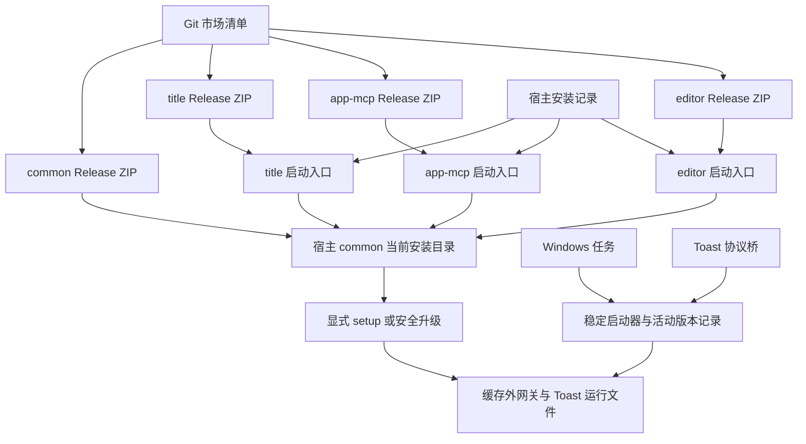

# 独立共享 common 与 Release 分发改造规格

**状态**：2026-10-20 用户已确认方案和九票顺序；任务票已发布为 [#113–#121](https://github.com/ONEGAYI/ZCode-Plugins/issues/113)，尚未实施、试装或发布产物。

**本轮授权**：发布九张任务票，并将方案与票据文档经 PR 合入 dev；不实施运行代码，不执行安装、系统注册、Release 发布或正式集成到 master。

## 1. 问题、目标与边界

当前原生安装只复制源码。用户另行安装的 npm 依赖和业务端公共包链接位于版本缓存内，重装、升级或清理缓存后需要修复。缓存外的 common/runtime 也是指向版本缓存的链接，并未保存独立运行文件。

本方案将四个插件改为构建期准备完整发布目录、GitHub Release 托管 ZIP、Git 市场清单指向固定资产 URL。common 继续作为独立插件发布；三个业务 ZIP 不携带 common 的实现副本。

这里的“安装后依赖完整”指：市场安装完成其依赖集合后，不再需要用户执行 npm 或建立包链接。它不表示每个业务 ZIP 可以脱离 common 独立运行，也不消除 Node、sqlite3 或操作系统能力要求。

### 成功标准

- 从干净的隔离环境安装四个发布 ZIP，无源码工作树、开发 node_modules 或历史 junction，仍能加载全部声明入口与资源。
- 三个业务插件共同定位同一安装记录中的 common 当前版本；发布检查证明业务产物未内联 common 实现。
- 原生更新不再要求 npm ci、link.mjs 或本机 UI 构建；源码开发依赖仍由开发者按锁文件安装。
- 网关、Toast 的长期注册命令均不引用版本缓存。迁移完成后删除旧缓存，网关可再次启动，已有 Toast 按钮可执行修复动作。
- 配置、授权、标题策略、工件库、编辑器状态及既有开关不因打包而迁移到发布包或缓存。
- 资产先可访问并通过 SHA-256 核验，正式市场清单随后切换；失败时不会把用户引向不存在的包。

### 范围外

不修改 ZCode 宿主或研究用 submodule，不增加安装钩子、更新守护进程、私有 Release 认证、自动下载执行器、公共 npm 发布或新的通用插件框架。不改命名策略、MCP 工具语义、编辑器功能、远控协议及既有权限边界。

本轮不实现 Mac 网关、通知或 GUI 环境支持，不接管既有 Mac 适配票。JS 构建与路径契约保持可移植，Windows 系统入口在 Windows 验证。既有编辑器和宿主 UI 未验事项继续保留，不能由包装验收代替。

## 2. 已确认事实与依据

| 事实 | 对方案的约束 |
| --- | --- |
| ZIP 安装不执行 npm 或插件初始化 | 所需 JS 依赖在构建时进入对应产物 |
| 市场 dependencies 解析安装依赖，不提供 Node 包解析 | 业务必须有独立于 npm 的 common 定位入口 |
| 安装遍历整个依赖集合，未承诺跳过已装 common | 保证业务包不夹带 common；不承诺网络只下载一次 |
| common/runtime 和业务 node_modules 公共入口均为链接 | 原生发布模式取消这些运行依赖，不能把链接称为外置副本 |
| 网关任务和 Toast VBS 保存当前缓存代码路径 | 长期启动目标必须部署到缓存外真实目录 |
| gateway-build 启动时扫描源码与 node_modules/ws | 改为识别实际发布运行文件，不能只调整入口路径 |
| title 调用 sqlite3 CLI；两个 MCP 使用 node:sqlite | 保留 Node 24+ 和 title 的 sqlite3 要求，不新增 SQLite 原生 npm 扩展 |

固定源码基线：本方案工作树基于 dev 的 73a9c2e94e551b8980c884370a7a82ec7210d617；官方研究快照为 0a1fc56d279fd1001f78387bd81aec1c26767411。二者都不等于本方案已经完成实际宿主验证。

主要依据：

- [现有公共链接](https://github.com/ONEGAYI/ZCode-Plugins/blob/73a9c2e94e551b8980c884370a7a82ec7210d617/suian-zcode-common/link.mjs)、[现有网关安装](https://github.com/ONEGAYI/ZCode-Plugins/blob/73a9c2e94e551b8980c884370a7a82ec7210d617/suian-zcode-common/setup.ps1)、[现有通知安装](https://github.com/ONEGAYI/ZCode-Plugins/blob/73a9c2e94e551b8980c884370a7a82ec7210d617/suian-zcode-common/notification-install.mjs)。
- [官方 ZIP 规格](https://github.com/zai-org/ZCode/blob/0a1fc56d279fd1001f78387bd81aec1c26767411/docs/plugin-cdn-zip-source.md)、[安装与依赖实现](https://github.com/zai-org/ZCode/blob/0a1fc56d279fd1001f78387bd81aec1c26767411/apps/zcode-cli/packages/adapters/src/plugins/marketplace.ts)、[下载、摘要与请求头实现](https://github.com/zai-org/ZCode/blob/0a1fc56d279fd1001f78387bd81aec1c26767411/apps/zcode-cli/packages/adapters/src/plugins/zip-source.ts)。
- [官方独立 node-repl-host 边界](https://github.com/zai-org/ZCode/blob/0a1fc56d279fd1001f78387bd81aec1c26767411/apps/zcode-cli/packages/bootstrap/src/app/official-plugin-definitions.ts)。官方有宿主注入通道，本方案不依赖该专属通道。
- [esbuild 多入口与共享分块](https://esbuild.github.io/api/#splitting)、[构建输入元数据](https://esbuild.github.io/api/#metafile)、[GitHub Release 不可变性](https://docs.github.com/en/code-security/concepts/supply-chain-security/immutable-releases)。

## 3. 用户故事

1. 作为插件用户，我希望市场安装完成后即可使用业务插件，免去重复安装依赖。
2. 作为多个插件的用户，我希望它们共享 common 的同一当前安装版本，避免每个业务包附带一套公共实现。
3. 作为升级用户，我希望已有配置、状态、模型选择和暂停状态保留，避免升级改变使用行为。
4. 作为升级用户，我希望网关在安全时机切换版本，并知道磁盘版本和正在运行的版本是否一致。
5. 作为清理缓存的用户，我希望已配置的后台网关和修复通知入口仍可启动，并能明确识别缺失的插件内容。
6. 作为通知接收者，我希望点击旧通知时诊断当前安装状态，而不是打开已经删除的旧代码路径。
7. 作为只用文本编辑的用户，我希望安装编辑器不会额外启动或注册网关。
8. 作为遇到安装损坏的用户，我希望得到明确修复步骤，不把依赖缺失、版本不兼容或未初始化混为一谈。
9. 作为维护者，我希望从确定的构建输入生成可追溯产物，并让市场清单只引用已发布且可校验的资产。
10. 作为维护者，我希望发布失败或重复执行时能定位已完成阶段，避免覆盖现有资产或重复注册系统对象。
11. 作为开发者，我希望源码调试与正式发布使用清晰分开的路径，不把开发用链接变成用户安装步骤。
12. 作为卸载用户，我希望只移除指定插件的注册，保留其他插件、公共服务及数据的边界清楚可见。

## 4. 架构与所有权

common 仍拥有公共协议、网关客户端、授权、通知、投影和共享标题策略实现。业务保留命名规则、提示词、会话工具与编辑行为。common 不反向导入业务插件。

同一安装存储根内，业务读取同一个 common 安装条目。共享的是代码文件；不同业务进程仍有自己的模块实例。需要跨进程共享的连接继续由已有唯一网关承载，不把普通函数调用改成新的 MCP 服务。

客户端加载检查 common 是否已安装及 API 是否兼容；插件启用状态控制其宿主 Hook 等组件，不把“已停用”当作“已卸载”。setup 根据用户所需组件核对启用状态，不隐式开启另一插件或重启服务。

网关和 Toast 的缓存外部署是保障长期启动所需的最小副本，不包含三份业务 common 客户端。此处刻意保留少量公共执行文件的副本，不能宣称磁盘上绝无重复。

## 5. common 定位与公共接口

### 5.1 发布契约

common 提供一个稳定的客户端模块入口，覆盖现有业务实际导入的公共函数与协议类型。入口不导入 gateway 主程序、安装器或扫描磁盘计算指纹的模块，不因 import 启动后台服务或修改系统。

common 内多入口构建可共享 ESM chunks；业务把公共导入转换为本地薄适配模块，再由薄适配模块加载 common 的绝对 file URL。仅把裸包名列为 external 不足以完成改造，发布包不能遗留依靠 node_modules 查找 common 的路径。

薄适配模块只依赖 Node 内置模块，其源码统一维护、构建时分发到业务包。它只负责定位、检查兼容契约和导入，不复制 common 业务实现。业务进程首次加载时固定所选 common 根及 buildId；之后不在每次调用中热换模块。

### 5.2 定位规则

原生模式以宿主提供的数据目录所属插件存储根为锚点，读取该根的 installed_plugins.json，按完整插件身份定位 common 的 installPath。首票须以目标宿主的 Hook、MCP、技能及 CLI 实际上下文逐一固定这一锚点；未注入同样变量的入口须显式传入安装记录路径。

不得只拼默认用户目录，也不靠 common 与业务缓存同级、遍历版本目录、选最高版本或读取旧 runtime junction 猜测。自定义宿主存储根必须有隔离契约；源码独立调试通过显式 common 根或安装记录参数提供位置，不新增全局环境变量。

边界输入校验只针对安装记录、身份、声明入口和兼容元数据。缺少 common、记录损坏、路径不存在或 API 不兼容时，入口在业务副作用前失败并报告具体阶段；不自动 npm install、不自动修链、不静默切到源码或旧缓存。

### 5.3 元数据

每个发布目录包含 release.json，字段职责固定为：formatVersion、pluginName、pluginVersion、buildId、入口映射、发布文件及摘要、公共 API 标识。业务另声明所需 commonApiVersion 和 minimumCommonVersion；common 声明其 commonApiVersion。

第一代公共 API 为 1。具体插件发行版本在实施后的正式集成范围确定，不在方案中虚构版本号。新 API 不兼容时必须协调受影响业务发行；兼容版本内保留旧消费者所需导出，不在动态加载失败后尝试另一版本。

buildId 根据规范化发布输入及运行文件计算，不读取整个工作树；文件清单不包含自身摘要，避免自引用。运行中的服务在启动时固定指纹，健康查询不从新磁盘产物伪造当前运行版本。

## 6. 打包与资源规则

| 发布包 | 必须覆盖的实际入口与资源 |
| --- | --- |
| common | 公共客户端入口、网关与指纹入口、依赖诊断 Hook、安装/状态入口、Toast 执行器、Windows 启动资源、skills、清单与第三方许可 |
| title | CLI、Stop 派发与 worker、安装/诊断入口、提示词与 Toast 业务模板、skills、Hook 与插件清单 |
| app-mcp | stdio CLI、安装入口、工件 SessionStart/UserPromptSubmit/Stop 入口、原生 UI、skills、MCP/Hook/插件清单 |
| side-editor | stdio CLI、实际构建的 editor.html、CodeMirror 等许可、现有 setup、MCP/插件清单 |

Node 构建使用锁定的 esbuild 和 Node 24 目标，保留 ESM 的命令入口判定与资源根语义。现有 import.meta.url、子进程 worker 路径、提示词与 HTML 相对位置逐项迁移；不能只证明 esbuild 命令返回成功。

SDK、zod 等业务自身依赖进入对应业务产物。本轮不额外把这些库抽进 common，仅禁止 common 实现被重复打入业务。common 的 ws 进入公共产物；ws 的可选原生加速包不成为发布必需品。

发布目录按允许清单组装，包含隐藏的插件清单目录；排除 node_modules、测试、研究 submodule、开发日志、个人配置、数据、凭据和绝对本机路径。保留 LICENSE、vendor NOTICE 以及相关第三方许可。生成目录和 ZIP 不进源码 Git 历史。

每插件一个 ZIP，插件根直接位于压缩包根。市场设置 stripRoot:false，省去多顶层与子目录的歧义；组装检查必须实际解压后读取清单、入口和资源。压缩由锁定实现控制，规范排序、时间和路径；同一轮发布只生成一次正式 ZIP，后续阶段复用其字节。

构建输出 metafile。业务输入不得包含 common 实现或公共 vendor，允许的薄适配模块单独列明；运行时不得回溯开发目录。开发者仍在源码中使用锁文件与开发依赖，开发路径不作为正式验收证据。

## 7. 网关的稳定启动与升级

### 7.1 目录和启动目标

继续保留现有网关数据目录 ~/.zcode/tools/suian-zcode-gateway，不迁移端口、令牌、模式及环境备份。新增代码部署根位于 ~/.zcode/tools/suian-zcode-common/deployments/{{BuildId}}，只复制 common ZIP 中网关、Toast 需要的运行文件及其资源闭包，使用真实文件而非 junction。

缓存外 launchers 目录保存稳定启动脚本。活动网关记录和活动 Toast 记录分开保存，分别选择部署版本及实际 Node 可执行文件，防止更新通知入口顺带切换正在运行的网关。

计划任务指向稳定 VBS/PowerShell 启动器，再读取活动网关记录启动已部署的 gateway。仍保留隐藏窗口、监督等待、真实退出码和既有重试策略；不会把旧缓存路径编码进任务参数、工作目录或子进程参数。

### 7.2 升级顺序

1. 从明确的已安装 common 或源码候选中校验发布元数据，暂存并检查运行文件；暂存不改变活动版本。
2. 查询实际网关、任务和 Desktop 状态。Desktop 活跃时保留旧服务，报告有候选版本；不自动退出 Desktop、不抢占连接。
3. 按既有流程暂停移动端远控，确认 desktop_connected:false，等待旧网关、监听和监督启动器退出。
4. 保存本次要修改的活动版本记录、任务及配置归属，原子切换活动记录并复用原任务启动候选。
5. 核对健康指纹、协议、模式与监听，再按既有约定修改用户环境并广播。端口、control_token、自定义上游和原环境备份保留。
6. 候选启动失败时回到之前部署的活动版本和本次修改的自有配置；首次安装没有旧部署时，撤销本次新增注册与环境修改并明确报告未安装成功。报告原错误及回退结果，回退失败不宣称恢复成功，不覆盖并发外部修改。

只变缓存路径但运行内容相同，不因路径变化要求重启。Status 分别报告可用候选、活动部署和运行中 buildId，明确待重载、不可达及未知；健康超时不能等价于已停止。

删除版本缓存后，已激活的网关仍从部署目录重启。业务公共模块缺失仍需修复原生 common 安装；稳定网关不被当作 common 缓存的替代来源。

首次迁移前核对现有任务归属及运行路径。旧任务确认切换成功前保留回退信息，旧 runtime junction 最后才停止作为生产路径；不删除用户源码或未经确认的真实目录。本轮不做自动旧部署垃圾回收，只清理本次失败暂存。

## 8. Toast 的稳定入口与业务归属

common 与 title 保留各自的协议、AUMID、快捷方式、数据与冷却范围。每个协议仍只接受原有 fix 动作，URI 不提供任意文件或命令执行能力。

现有调用方数据目录中的 toast-launch.vbs 改为引用缓存外稳定 Toast 启动器。启动器通过活动 Toast 记录加载 common 部署的执行器，不依赖 common 或 title 版本缓存；快捷方式工作目录也不能指向缓存。

执行器仅支持当前两类动作：common 的依赖诊断修复、title 的网关排障提示。剪贴板和打开固定默认工作区仍由 common 实现。title 维护自己的提示词模板，安装时将该模板和身份描述复制到 title 的外置数据目录；common 不反向读取或导入 title 缓存代码。

点击时重新读取安装记录。common 动作重扫当前依赖状态；title 模板中的插件位置使用当前安装条目。缺失时明确写入修复提示，不把已不存在的旧路径当作可执行入口。即便整个插件缓存暂缺，已经部署的通知执行器和外置模板仍可复制修复提示。

更新通知执行器先校验并部署，再切换 Toast 活动记录；旧部署在切换失败时仍可用。业务卸载只清理归属匹配的自身协议、快捷方式和描述，不能移除另一身份或共享网关。缺少身份描述时明确失败，不默认采用另一插件的数据。

自动测试注入通知、注册表、任务、剪贴板与打开工作区边界；不得激活真实协议。真实按钮操作另列人工验收，不能用生成 VBS 文本代替。

## 9. Release、市场清单与提交证据

### 9.1 清单契约

市场本身继续来自 Git。四个条目的 source 分别为对象，字段为 source=url、type=zip、固定 HTTPS url、64 位小写 sha256、stripRoot=false。三个业务保留 dependencies=[suian-zcode-common]。

URL 使用明确 Release tag 和带插件版本的资产名，不使用 latest、临时重定向 URL 或源码归档。插件清单、已有 package/lock 根版本、运行时自报及市场 version 必须一致。按实际影响升版；首次切换涉及四个包，后续 common 兼容更新不强迫未变业务重新打包。

公开 ZIP 不设置 Authorization、Cookie 等敏感 headers；本轮不支持私有资产下载。GitHub Release 是否已启用不可变性须在实际发布前读取，启用属于另行授权的仓库设置操作。

### 9.2 一次构建与最终提交

1. 先在开发分支完成受影响代码、配置、skills、许可及版本字段，确定构建输入集合。
2. 在隔离 staging 构建四包并生成最终 ZIP、文件摘要及输入摘要；用这些 ZIP 的摘要生成候选市场清单。
3. 将源码、版本及候选清单形成最终候选提交 C。比对 C 的构建输入摘要与已有 ZIP 的输入摘要完全一致；不为记录 C 把提交 SHA 塞回 ZIP 引发循环依赖。
4. 发布证据在 ZIP 外记录 C、基线、构建工具、输入摘要、ZIP 摘要和测试日志。针对 C 运行一次正式门禁，直接使用已有 ZIP。

正式合并若只改变提交身份而构建输入及测试范围未变，保留等同性证明并复用有效证据；发生受测输入、环境或验证假设变化时先说明，再重跑受影响部分。不能因为推送、PR、复审或合并阶段切换重复全量。

### 9.3 公开顺序与幂等

取得对应发布授权后，按以下顺序操作：

1. 读取同名 tag、Release 和资产，校对候选 C 及摘要；不存在才创建草稿，已有内容不覆盖。
2. 将正式 ZIP、摘要与脱敏构建记录上传到草稿。发布草稿前确认资产齐全；公开资产阶段可先标为预发布。
3. 通过清单中的固定公开 URL 实际下载并核对 ZIP 摘要、解包及目标宿主安装。草稿下载权限不能代替匿名公开下载证据。
4. 资产就绪且正式集成已获授权后，再将候选市场清单随 dev 已验证内容合入 master。仓库默认市场来源分支只在此时对用户暴露新 URL。
5. 核对 master 的版本、URL 与摘要，再按已授权范围调整 Release 预发布标记；只改元信息，不重压、重传或替换 ZIP。

本顺序允许 Release 资产先于 master 清单公开，避免正式市场先指向 404；该外部公开本身仍需要发布授权。未获正式合并许可时，清单保持原正式版本，报告“资产已备/待集成”，不能宣称发行完成。

请求超时或结果不明时先读取现状再续作。资产已公开后发现需要改变其字节，使用新插件版本和新 tag，不删除重传同名资产。清单切换失败可保留已公开资产，不自动删除 Release。

推送前 fetch，按仓库规则处理基线前移。若构建输入变化，旧证据不能冒充新版本凭证；不改写已发布历史。原始 ZIP 若未保存，只下载并核验已有资产，不为阶段收尾重新构建。

### 9.4 回退

清单回退引用已核验的旧 URL、旧摘要及配套版本集合，不改旧资产。网关通过明确的回退操作选择上一已部署版本，遵守 Desktop 断开约束；Toast 可独立回退。

首次从 Git 源码分发迁移时，旧版可能没有 Release ZIP。其回退需要恢复原市场来源并按旧流程恢复 npm 与链接，不能承诺首次迁移也能无 setup 回退。公共数据默认不回滚；若后续引入不兼容数据迁移，必须另行规定备份恢复，不藏进本票。

## 10. setup、configuration 与诊断同步

| 技能或文档 | 随行为同步的修改 |
| --- | --- |
| common/setup | 删除原生 npm/link 步骤；检查包完整性与 API；区分市场安装、服务部署和安全激活；首次初始化、升级、回退、移除明确分开 |
| common/configuration | 从部署入口执行状态/配置操作；保留 Desktop 版本选择、协议、模式和环境生效规则；不因普通业务升级重启网关 |
| title/setup、configuration | 使用发布入口；保留 Node/sqlite3、真实模型选择、首次暂停与原开关恢复；部署 Toast 模板；配置变更不触发依赖重装 |
| app-mcp/setup、configuration | 取消原生 npm/link；MCP 与工件 Hook 使用同一外置配置；保留旧服务迁移、实际进程重连与来源核对 |
| editor/setup | 取消原生 npm/link/UI 构建；文本编辑不部署网关；评论连接及既有待验边界继续明确 |
| 各 paths/debug、根路由 SKILL、README/AGENTS/CONTEXT | 定义源码与发布入口、安装缓存/部署代码/业务数据三种归属；当前实现完成后更新术语，不把本草稿当成现状 |

editor 当前没有 configuration 技能；不为对齐目录而新增，已有配置说明随实际入口维护。所有技能步骤须能对应可执行的最终发布入口，不能残留源码路径。

depcheck 改查发布文件、运行入口、安装身份、common API 兼容及部署状态，不能继续要求生产 node_modules 或 junction。只要诊断入口本身仍存在，它应保持纯 Node 自举，不因公共客户端损坏而无法运行；common 缓存整个删除时由已部署的稳定 Toast 提供诊断，不能承诺被删除的 Hook 自行执行。缺包修复指向原生重新安装/更新，服务未激活指向 setup，二者不混为 npm 缺失。

仅检查模式不写文件、不注册系统对象、不启动网关。安装业务不强制开启或重启网关。原生启用/卸载的数据语义以实际宿主为准：update 保留 data；默认彻底卸载可能删除宿主 data，需保留数据时先备份或使用已核实的 keep-data 入口，不能继续笼统承诺原生卸载一定保留配置。

## 11. 迁移与执行顺序

采用先扩展、分批迁移、最后收敛的方式。先增加新 common 产物和定位契约，再依次完成三个业务包及两个长期入口，最后才切换正式市场与移除生产链接依赖。

中间提交只用于开发验证，生产市场仍沿用旧来源。首次切换使用已验证的四包配套集合；先记原开关、暂停 title 并等待 worker 收尾，再安装配套版本、迁移服务与通知、重连 MCP、恢复原状态。不会让正在执行的业务进程跨版本热换 common。

link.mjs 可保留为明确的源码开发工具；正式技能、清单、诊断及包内容不依赖它。旧链接清理仅移除已确认链接本身，不递归删除目标，旧源码和数据留作首次回退。

任务及实际 Issue 编号见[开票索引](shared-runtime-release-tickets.md)。2026-10-20 用户已确认本方案、九票粒度与依赖顺序，并授权发布 Issues 和将文档合入 dev；代码实施仍需后续指令。

## 12. 验证矩阵与证据

| 层级 | 必须证明的行为 | 边界 |
| --- | --- | --- |
| 契约红绿 | 安装记录定位、API 拒绝、真实资源路径、无公共代码内联、稳定入口切换与失败回退 | 在对应实现前添加能暴露旧问题的测试 |
| 解包集成 | 独立临时根中三个消费者加载同一 common，删除开发依赖后 stdio/Hook/worker/页面仍可用 | 使用正式 ZIP 字节，禁止 NODE_PATH 和源码目录逃逸 |
| 系统隔离 | 任务、协议、模板、活动记录、配置、退出码和回退 | 真实文件系统配合现有系统边界桩，不改用户任务/注册表/剪贴板 |
| URL 安装 | 固定 URL、跳转、摘要、根清单、版本、依赖集合及失败拒绝 | 本地 HTTP fixture 先测，正式公开 URL 在授权发布后验证 |
| Windows 实机 | 升级、旧缓存删除后的网关重新启动、Toast 实际按钮、原生 MCP/Hook/UI 与状态保留 | 固定实际 Desktop/CLI/rootPath/dataPath；人工协议交互与专用测试会话 |

必须覆盖：common 缺失/损坏/API 不兼容、自定义存储根与带空格中文路径、同版本重装、common 单独兼容更新、只升级业务、运行进程仍旧版、网关活跃拒绝切换、候选启动失败、旧缓存删除、旧通知点击、只编辑文本、不完全卸载、网络失败/摘要不匹配，以及中断后的重复续作。

首次长耗时验证即记录日志和退出码，后续统计从原日志读取。门禁记录绑定提交、基线、脚本、工具、临时文件系统和 ZIP 摘要；复用同一有效记录，不追加一轮“合并前全量”。只写文档的本轮仅检查文档、链接与任务依赖，不运行构建或功能回归。

## 13. 仍需执行阶段核实的条件

- 目标 Desktop 实际版本对 ZIP 源、Hook/MCP 环境与自定义存储根的行为：首票和最终验收分别验证，源码支持不等于实机通过。
- 正式 tag、四插件目标版本、仓库公开下载条件和 Release 不可变性设置：实际发布前读取和确定；本方案不代选版本或修改设置。
- 真实协议按钮与完整网关重载的人工窗口：缺少时保留对应票未验，不能用脚本生成或接口 probe 关闭。
- 当前基线继续有其他会话推进：实施前重新 fetch、核对本方案涉及入口，不要求合并与本主题无关的历史票。

本节列的是执行条件，不改变已选架构；发现缺少宿主能力时，对应实现或验收票保持阻塞并给出证据，不擅自改造宿主或扩大成平台适配项目。
