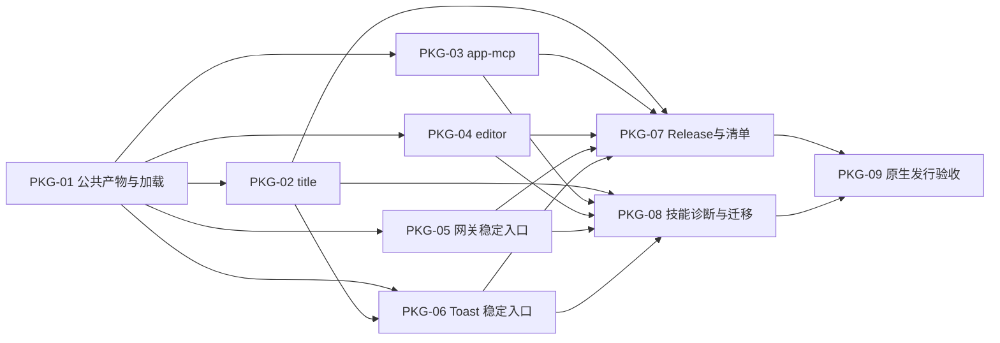

# 独立共享 common 与 Release 分发开票索引

**状态**：2026-10-20 用户已确认完整规格、票粒度和顺序；九票已发布为 #113–#121，尚未实施代码或发布产物。

主规格见[改造规格](shared-runtime-release-spec.md)。沿用仓库已有[开票约定](../../suian-zcode-app-mcp/docs/agents/issue-tracker.md)，不建立另一套跟踪器。

## 顺序与依赖

| 本地票 | GitHub Issue | 交付行为 | Blocked by |
| --- | --- | --- | --- |
| [PKG-01](shared-runtime-release-tickets/01-shared-common-contract.md) | [#113](https://github.com/ONEGAYI/ZCode-Plugins/issues/113) | 独立 common 发布目录及无 npm 链接的公共加载契约 | 无 |
| [PKG-02](shared-runtime-release-tickets/02-title-package.md) | [#114](https://github.com/ONEGAYI/ZCode-Plugins/issues/114) | title 正式包覆盖 CLI、Stop worker、提示词及安装入口 | #113 |
| [PKG-03](shared-runtime-release-tickets/03-app-mcp-package.md) | [#115](https://github.com/ONEGAYI/ZCode-Plugins/issues/115) | app-mcp 正式包覆盖 stdio、工件 Hook 与原生面板 | #113 |
| [PKG-04](shared-runtime-release-tickets/04-editor-package.md) | [#116](https://github.com/ONEGAYI/ZCode-Plugins/issues/116) | editor 正式包覆盖实际 UI、stdio 与外置状态 | #113 |
| [PKG-05](shared-runtime-release-tickets/05-gateway-stable-runtime.md) | [#117](https://github.com/ONEGAYI/ZCode-Plugins/issues/117) | 网关缓存外部署、稳定任务入口、安全切换与失败回退 | #113 |
| [PKG-06](shared-runtime-release-tickets/06-toast-stable-runtime.md) | [#118](https://github.com/ONEGAYI/ZCode-Plugins/issues/118) | 两种 Toast 身份在缓存删除后仍可执行修复动作 | #113、#114 |
| [PKG-07](shared-runtime-release-tickets/07-release-marketplace.md) | [#119](https://github.com/ONEGAYI/ZCode-Plugins/issues/119) | 一次打包、Release 分阶段发布和市场清单生成 | #114、#115、#116、#117、#118 |
| [PKG-08](shared-runtime-release-tickets/08-setup-migration.md) | [#120](https://github.com/ONEGAYI/ZCode-Plugins/issues/120) | 原生无 npm/link 的 setup、configuration、depcheck 与旧安装迁移 | #114、#115、#116、#117、#118 |
| [PKG-09](shared-runtime-release-tickets/09-native-release-acceptance.md) | [#121](https://github.com/ONEGAYI/ZCode-Plugins/issues/121) | 实际 ZIP/URL 升级、缓存清理和 Windows 原生验收 | #119、#120；真实环境及对应发布授权 |

九票采用“先扩展、分批迁移、最后收敛”。PKG-01 先提供可运行的公共产物和加载烟测；各业务票贯穿启动、资源及行为检查，不拆成仅构建/仅接口/仅测试的横向票。PKG-07 和 PKG-08 可分别完成发布操作链与用户迁移链，不依靠相互引用形成循环。

PKG-01 至 PKG-08 是实现票，包含对应契约测试与必要文档；PKG-09 是有外部条件的发行验收票。外部条件不具备时，不关闭为完成，也不无限重跑本地检查。

## 当前固定选择

- common 独立共享，业务包不内联其实现；定位来自实际安装记录，不再依赖生产 junction。
- 只把网关与 Toast 的运行文件闭包部署到缓存外真实目录，保留业务数据归属。
- Release 固定版本 ZIP 与 SHA-256；先资产可访问，再切换正式市场清单。
- 原生用户无需 npm/link；源码开发入口保留，editor 不新增 configuration 技能或强制安装网关。
- 当前九票只针对本改造；不关闭或扩大既有编辑器、宿主 UI、Mac 适配票。

## 发布记录与授权

用户确认后已按拓扑顺序创建 GitHub Issues。首票 [#113](https://github.com/ONEGAYI/ZCode-Plugins/issues/113) 附完整规格和系列依赖索引，后续票的 Blocked by 使用实际编号。各票保持开放，文档提交不自动关闭实现票。

2026-10-20 发布前重新读取现有标签：九票均使用 enhancement，仅无实施票阻塞的 #113 使用 ready-for-agent，其余正文明确前置依赖；未新建或覆盖标签。旧开票文档当时“没有 ready-for-agent”的记录保留为历史事实。

用户本轮已授权开票及文档经 PR 合入 dev。运行代码实施、正式合入 master、tag/Release、仓库设置和真实系统注册未包含在本次授权内，执行对应票时仍须遵循授权边界。

## 本轮文档检查

已核对规格、索引与九票的本地文档链接、必需字段、独立验收条件和依赖无环；发布后补充实际编号并复核一致性。仅改 Markdown 文档及文档导航，未执行构建、功能回归或宿主试装，用户主工作树保持干净。

## GUL 系列：网关升级忙退避与幂等锁（2026-10-21）

**状态**：2026-10-21 用户确认方案与四个设计决策（`rpc_in_flight` 空闲判定、超时放弃报 `remote_busy`、独占句柄事务锁、拿锁失败明确报错）后开票实施；四票已发布为 [#134](https://github.com/ONEGAYI/ZCode-Plugins/issues/134)–[#137](https://github.com/ONEGAYI/ZCode-Plugins/issues/137)，实施于独立工作树分支 `feat/gateway-upgrade-backoff-lock`，2026-10-21 已完成实施与双轴代码审查（含审查修复），待正式集成。

背景：网关升级从"要求用户手动暂停远控"演进为"忙时自动退避、空闲闪断切换、幂等防重入"。依据是 Desktop V2 连接层自带断线自愈（官方源码快照证据），规格修订落在 GUL-04。沿用同一开票约定，不另建跟踪器。

| 本地票 | GitHub Issue | 交付行为 | Blocked by |
| --- | --- | --- | --- |
| [GUL-01](shared-runtime-release-tickets/10-gateway-idle-signal.md) | [#134](https://github.com/ONEGAYI/ZCode-Plugins/issues/134) | `/health` 暴露 `rpc_in_flight`；`/shutdown` 升级关闭模式（空闲放行、忙 409） | 无 |
| [GUL-02](shared-runtime-release-tickets/11-upgrade-transaction-lock.md) | [#135](https://github.com/ONEGAYI/ZCode-Plugins/issues/135) | setup.ps1 切换事务独占句柄锁，崩溃自动释放，防 activate 交叉 | 无 |
| [GUL-03](shared-runtime-release-tickets/12-busy-backoff-restart.md) | [#136](https://github.com/ONEGAYI/ZCode-Plugins/issues/136) | Restart/Remove 忙退避重探（默认 60 秒上限）、超时放弃报待激活 | #134、#135 |
| [GUL-04](shared-runtime-release-tickets/13-spec-docs-sync.md) | [#137](https://github.com/ONEGAYI/ZCode-Plugins/issues/137) | spec 7.2、common AGENTS.md、skills/setup 与索引同步 | #134、#135、#136 |

本轮授权范围：开票与本地实施（含测试）。推送、建 PR、合入 dev、关闭 issue 不在本次授权内，完成后交付验收。
